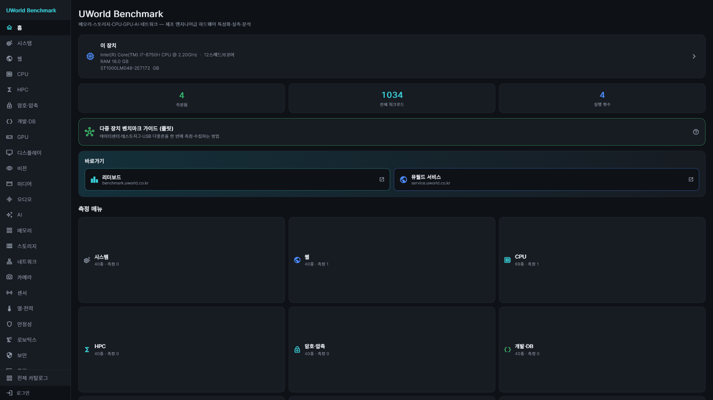
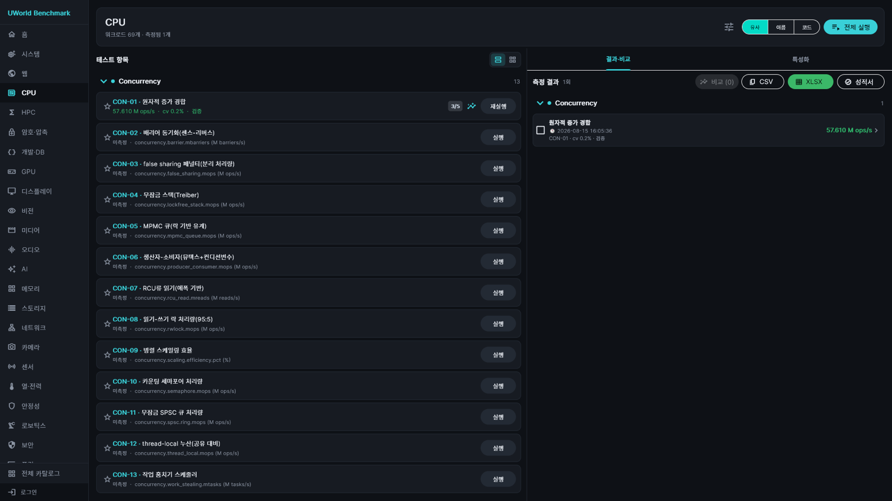
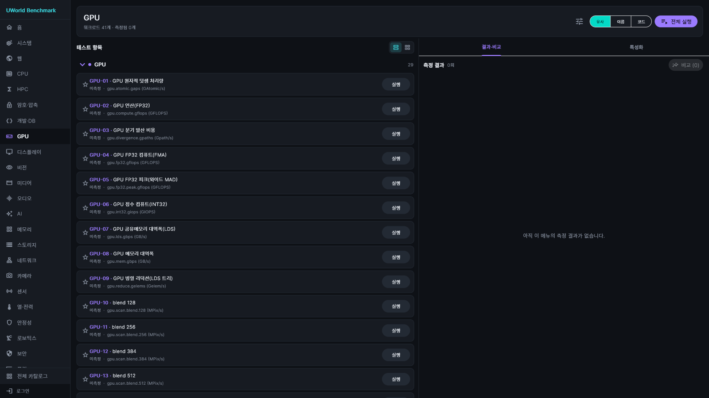
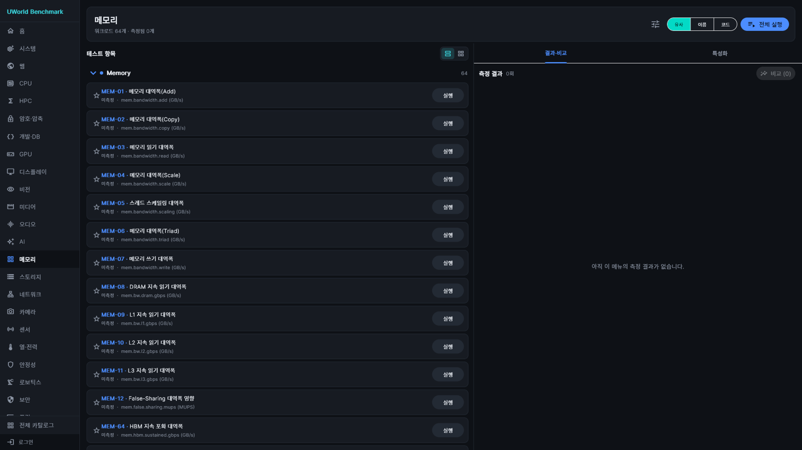
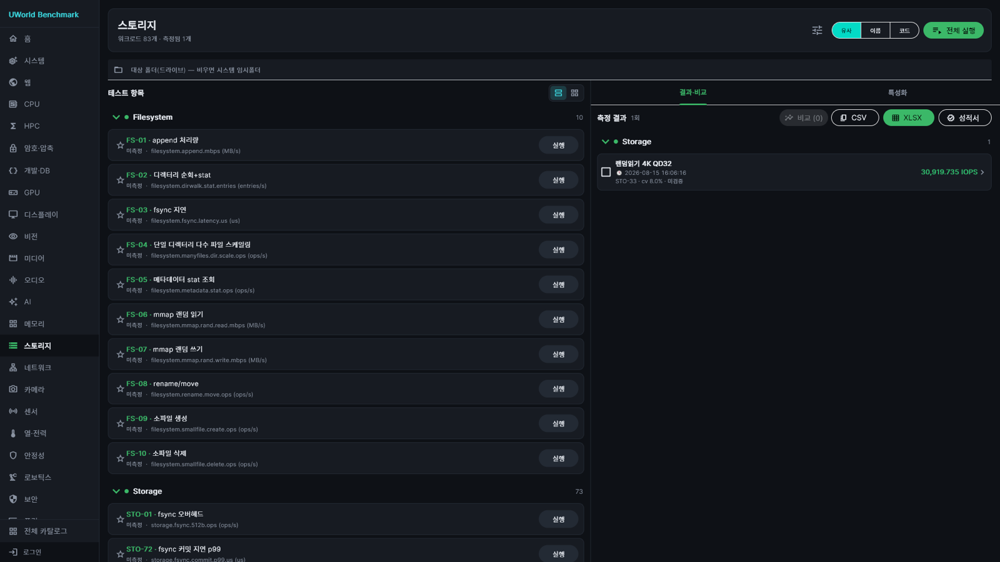
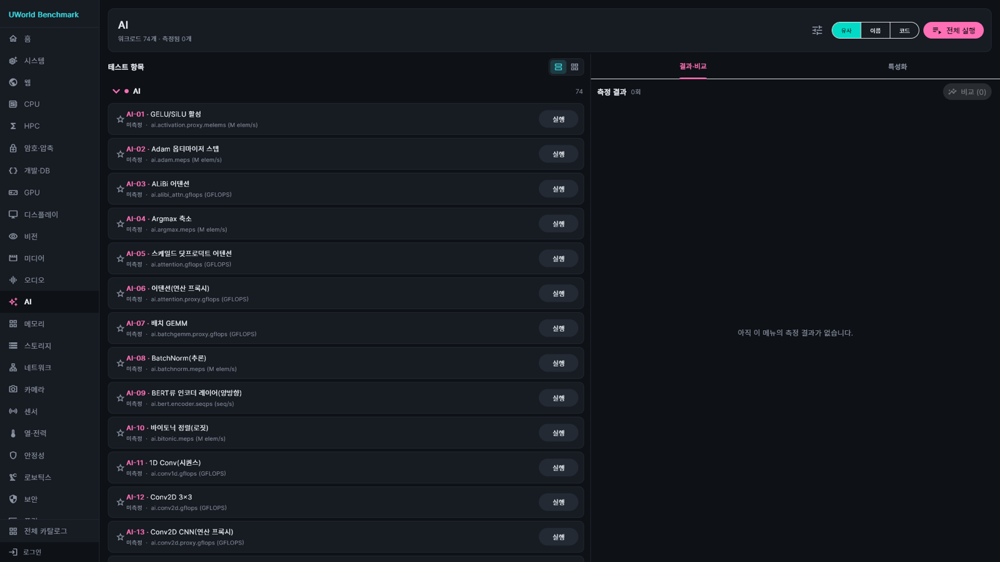

<div align="center">

# UWorld Benchmark · 유월드 벤치마크

**Engineer-grade hardware benchmarking for your PC, Mac, server and phone — one engine, five operating systems.**
**내 PC·Mac·서버·휴대폰 성능을 엔지니어 수준으로 실측합니다. 하나의 엔진, 다섯 개 OS.**

[](https://github.com/UWorld-Group/uworldbenchmark/releases/latest)
[](https://github.com/UWorld-Group/uworldbenchmark/releases)

| Windows | macOS | Android | iPhone · iPad |
|:---:|:---:|:---:|:---:|
| [**Download**](https://github.com/UWorld-Group/uworldbenchmark/releases/latest) | [**DMG**](https://github.com/UWorld-Group/uworldbenchmark/releases/latest) · [Mac App Store](https://apps.apple.com/app/id6814112939) | [Google Play](https://play.google.com/store/apps/details?id=kr.co.uworld.uworld_benchmark) | [App Store](https://apps.apple.com/app/id6814112939) |

</div>

## Screenshots · 화면

<p align="center">
  
  
</p>
<p align="center">
  
  
</p>
<p align="center">
  
  
</p>

---

## Why UWorld Benchmark · 왜 유월드 벤치마크인가

Most benchmarks give you a single score. UWorld Benchmark runs **real algorithms** (not synthetic spinners) across **21 menus, 32 domains and 1,000+ workloads**, from CPU micro-architecture and HPC math to GPU, modern AI kernels, memory, SSD latency distributions, networking, cryptography, media codecs, sensors and power.

Every result comes with a **confidence grade** based on the coefficient of variation, thermal-throttling detection and Peak vs. Sustained values, so you know how far you can trust each number. You can then analyze results like an engineer, with Cpk, Gauge R&R, normality tests, SPC control charts and 15 statistical chart types.

대부분의 벤치마크는 점수 하나만 보여 줍니다. 유월드 벤치마크는 **21개 메뉴 · 32개 도메인 · 1,000개가 넘는 워크로드**에서 합성 부하가 아닌 **실제 알고리즘**을 돌려 CPU 마이크로아키텍처, HPC 수치연산, GPU, 최신 AI 커널, 메모리, SSD 지연 분포, 네트워크, 암호, 미디어 코덱, 센서·전력까지 측정합니다.

모든 결과에는 변동계수(CV) 기반 **신뢰도 등급**, 열 스로틀 감지, Peak·Sustained 값이 함께 붙어 숫자를 얼마나 믿을 수 있는지 알려 줍니다. Cpk·Gauge R&R·정규성 검정·SPC 관리도·15종 통계 차트로 엔지니어처럼 분석할 수 있습니다.

## Features · 주요 기능

### 🖥️ One engine, five operating systems · 5개 OS, 하나의 엔진
- The same C++ engine measures Windows, macOS, Linux, Android and iOS in exactly the same way, so results are directly comparable.
  같은 C++ 엔진이 Windows·macOS·Linux·Android·iOS를 똑같은 방식으로 측정해 결과를 그대로 비교할 수 있습니다.

### ⚙️ CPU, HPC & concurrency · CPU·HPC·동시성
- Atomic contention, branch prediction, cache walks, FMA throughput, GEMM, Cholesky, FFT, stencils, N-body, lock-free queues and false-sharing penalties.
  원자적 경합·분기 예측·캐시 워크·FMA, GEMM·콜레스키·FFT·스텐실·N-body, 락프리 큐·false sharing 페널티를 측정합니다.

### 🎮 GPU, display & media · GPU·디스플레이·미디어
- FP32 peak, atomics, divergence, blending and compositing, plus codec kernels such as DCT/IDCT, CABAC and deblocking.
  FP32 피크·아토믹·분기 발산, 블렌딩·컴포지팅과 DCT/IDCT·CABAC·디블로킹 같은 코덱 커널을 측정합니다.

### 🤖 AI · AI 커널
- GEMM in FP32/INT8/INT4, convolutions, attention (SDPA/ALiBi), RoPE, softmax, KV-cache decoding in tokens/s and BERT layers.
  FP32/INT8/INT4 GEMM, 합성곱, 어텐션(SDPA/ALiBi), RoPE, softmax, KV-cache 디코드(tokens/s), BERT 레이어를 측정합니다.

### 🧠 Memory & storage · 메모리·스토리지
- STREAM bandwidth, latency, thread scaling and NUMA; SSD 4K latency percentiles (P50/P90/P99), IOPS, sequential, fsync, queue-depth and sustained (SLC) sweeps.
  STREAM 대역폭·지연·스레드 스케일·NUMA, SSD 4K 지연 백분위(P50/P90/P99)·IOPS·순차·fsync·큐 깊이·지속(SLC) 스윕을 측정합니다.

### 🌐 Network, security & more · 네트워크·보안 등
- TCP/UDP latency and loss against your own host, TLS/QUIC parsing, AES-GCM, ChaCha20, Argon2id, compression, developer/database kernels, sensors and robotics.
  직접 지정한 호스트로 TCP/UDP 지연·손실을 측정하고, TLS/QUIC 파싱, AES-GCM·ChaCha20·Argon2id, 압축, 개발·DB 커널, 센서·로보틱스까지 측정합니다.

### 📊 Engineer-grade analysis · 엔지니어급 분석
- Confidence grades, Cpk, Gauge R&R, SPC control charts, USL/LSL pass/fail gates, 15 chart types and CSV/XLSX export.
  신뢰도 등급, Cpk, Gauge R&R, SPC 관리도, USL/LSL 합격 판정, 15종 차트, CSV·XLSX 내보내기를 지원합니다.

### 🏭 Fleet testing for manufacturing · 제조용 플릿 측정
- Measure hundreds of devices from one console over LAN, USB or ADB, aggregate yield and connect to your MES.
  LAN·USB·ADB로 수백 대를 한 콘솔에서 측정하고 수율을 집계해 MES에 연동합니다.

### 🔒 Private, multilingual and free · 프라이버시·다국어·무료
- All measurements run on your device; nothing is sent to the developer. The global leaderboard is opt-in. 99 languages are built in and work offline, and the app is completely free.
  모든 측정은 기기 안에서만 이뤄지며 개발사로 데이터를 보내지 않습니다. 글로벌 리더보드 등록은 선택입니다. 99개 언어를 오프라인으로 내장했고 완전히 무료입니다.

---

## Install · 설치 안내

### Windows

**Requirements · 사양**: Windows 10 / 11 (64-bit). Administrator rights are needed to install.

1. Download **`UWorldBenchmark-<version>-windows-x64-setup.exe`** from the [latest release](https://github.com/UWorld-Group/uworldbenchmark/releases/latest).
   [최신 릴리스](https://github.com/UWorld-Group/uworldbenchmark/releases/latest)에서 설치 파일을 내려받습니다.
2. Run it and follow the installer. The installer is code-signed by **유월드 (UWorld)**.
   실행하면 설치가 진행됩니다(관리자 권한 필요). 설치 파일은 "유월드" 이름으로 서명되어 있습니다.
3. *(Optional)* Verify the file with `SHA256SUMS.txt` from the same release:
   *(선택)* 같은 릴리스의 `SHA256SUMS.txt` 로 파일이 변조되지 않았는지 확인할 수 있습니다.
   ```powershell
   Get-FileHash .\UWorldBenchmark-<version>-windows-x64-setup.exe -Algorithm SHA256
   ```

### macOS (DMG)

**Requirements · 사양**: macOS 12 or later, Apple silicon or Intel.

1. Download **`UWorldBenchmark-<version>-macos-universal.dmg`** from the [latest release](https://github.com/UWorld-Group/uworldbenchmark/releases/latest) and open it.
   최신 릴리스에서 DMG를 내려받아 엽니다.
2. Drag **UWorld Benchmark** onto **Applications**. The app is signed with UWorld's Developer ID and **notarized by Apple**.
   **UWorld Benchmark**를 응용 프로그램 폴더로 끌어다 놓습니다. 유월드 Developer ID 서명과 Apple 공증을 받은 앱입니다.
3. Prefer automatic updates? Install from the [Mac App Store](https://apps.apple.com/app/id6814112939).
   자동 업데이트를 원하시면 Mac App Store판을 설치하세요.

### Android · iPhone · iPad

Install from [Google Play](https://play.google.com/store/apps/details?id=kr.co.uworld.uworld_benchmark) or the [App Store](https://apps.apple.com/app/id6814112939).
[Google Play](https://play.google.com/store/apps/details?id=kr.co.uworld.uworld_benchmark) 또는 [App Store](https://apps.apple.com/app/id6814112939)에서 설치하세요.

---

## About this repository · 이 저장소에 대해

This repository is used **only to distribute installers**. The source code is not published here.
The "Source code" archives that GitHub attaches to every release contain only this README, the license and screenshots.

이 저장소는 **설치 파일 배포 전용**입니다. 앱 소스코드는 공개하지 않으며, 릴리스마다 GitHub가 자동으로 붙이는 "Source code" 압축 파일에는 이 안내문·사용권 안내·화면 이미지만 들어 있습니다.

## Support · 문의

- Website · 웹사이트: https://service.uworld.co.kr

<div align="center">

Part of **[UWorld Group](https://github.com/UWorld-Group)** · See [LICENSE.txt](LICENSE.txt) · © UWorld. All rights reserved.

</div>
